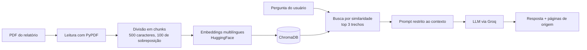
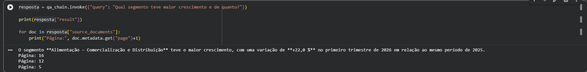

<h1 align="center">RAG para Análise de Mercado de Franchising</h1>

<p align="center">
  Pergunte em português sobre um relatório de mercado e receba respostas baseadas <b>apenas</b> no documento, com as páginas de origem.
</p>

<p align="center">
  
  
  
  
  
  
</p>

<p align="center">
  <a href="https://colab.research.google.com/drive/1Jqc5HiXg6KWnrNPkkiEyo22P1iw8xUvy?usp=sharing">
    
  </a>
</p>

---

## O problema

Relatórios de mercado são longos e densos. Encontrar um número específico, como qual segmento mais cresceu no trimestre, exige ler dezenas de páginas.
A ideia do projeto é transformar o relatório em uma base consultável por linguagem natural, sem que o modelo invente informação.

## Como funciona

O projeto usa **RAG (Retrieval-Augmented Generation)**: em vez de confiar no que o LLM "sabe", o sistema primeiro busca os trechos relevantes do documento e só então pede ao modelo que responda com base neles.



## Decisões técnicas

| Etapa | Escolha | Por quê |
|---|---|---|
| Divisão do texto | `RecursiveCharacterTextSplitter`, 500 / 100 | Trechos pequenos o bastante para uma busca precisa; a sobreposição evita cortar uma informação no meio |
| Embeddings | `paraphrase-multilingual-MiniLM-L12-v2` | O documento está em português; modelo leve, gratuito e roda no Colab |
| Banco vetorial | ChromaDB | Open source, local e simples de persistir |
| Recuperação | Similaridade, `k = 3` | Contexto suficiente sem diluir a resposta com trechos irrelevantes |
| LLM | `openai/gpt-oss-120b` via Groq, `temperature = 0` | Inferência rápida e gratuita; temperatura zero deixa as respostas mais determinísticas |
| Rastreabilidade | `return_source_documents=True` | Cada resposta mostra de quais páginas veio, para conferência |

## O ajuste que fez diferença: conter a alucinação

Na primeira versão, a cadeia usava o prompt padrão do LangChain. Testando, percebi que o modelo **respondia mesmo quando a informação não estava no documento**, misturando o relatório com o próprio conhecimento.

A correção foi um prompt que limita a resposta ao contexto recuperado e instrui o modelo a admitir quando não encontra a informação:

```text
Responda em português, usando apenas o contexto abaixo.
Se a resposta não estiver no contexto, diga que não encontrou essa informação no documento.
```

Com isso, o sistema passou a preferir "não encontrei" a inventar, que é o comportamento esperado de uma ferramenta de consulta a documentos.

## Exemplo de uso

```python
resposta = qa_chain.invoke({"query": "Qual segmento teve maior crescimento e de quanto?"})

print(resposta["result"])
for doc in resposta["source_documents"]:
    print("Página:", doc.metadata.get("page") + 1)  # PyPDF numera páginas a partir de 0
```

<p align="center">
  
</p>

## Como rodar

1. Abra o notebook no Colab pelo botão acima.
2. Crie uma chave gratuita em [console.groq.com](https://console.groq.com) e salve nos **Secrets** do Colab (ícone de chave) com o nome `GROQ_API_KEY`.
3. Faça upload do PDF do relatório para `/content/` e ajuste a variável `CAMINHO_PDF`, se o nome for diferente.
4. Execute as células em ordem, começando pela instalação.

> Se aparecer erro de versão ao importar as bibliotecas, use **Ambiente de execução → Desconectar e excluir ambiente de execução** e rode tudo de novo do início. Isso acontece quando o Colab mantém versões antigas carregadas na memória.

> O relatório usado é a pesquisa trimestral de desempenho do franchising da ABF (Associação Brasileira de Franchising). Ele não está no repositório por ser material de terceiros; está disponível no site da ABF.

## Estrutura

```
rag-analise-mercado-franchising/
├── pipeline_rag_analise_mercado.ipynb   # pipeline completo, documentado passo a passo
├── requirements.txt                     # dependências
├── img/                                 # prints usados no README
└── README.md
```

## Próximos passos

- Interface de chat com Streamlit ou Gradio
- Avaliar a qualidade das respostas com um conjunto de perguntas de referência
- Testar outros tamanhos de chunk e valores de `k`
- Consultar vários relatórios trimestrais e comparar períodos

---

<p align="center">
  Feito por <a href="https://github.com/SEU_USUARIO">Pedro Davi</a> ·
  <a href="https://linkedin.com/in/SEU_PERFIL">LinkedIn</a>
</p>
